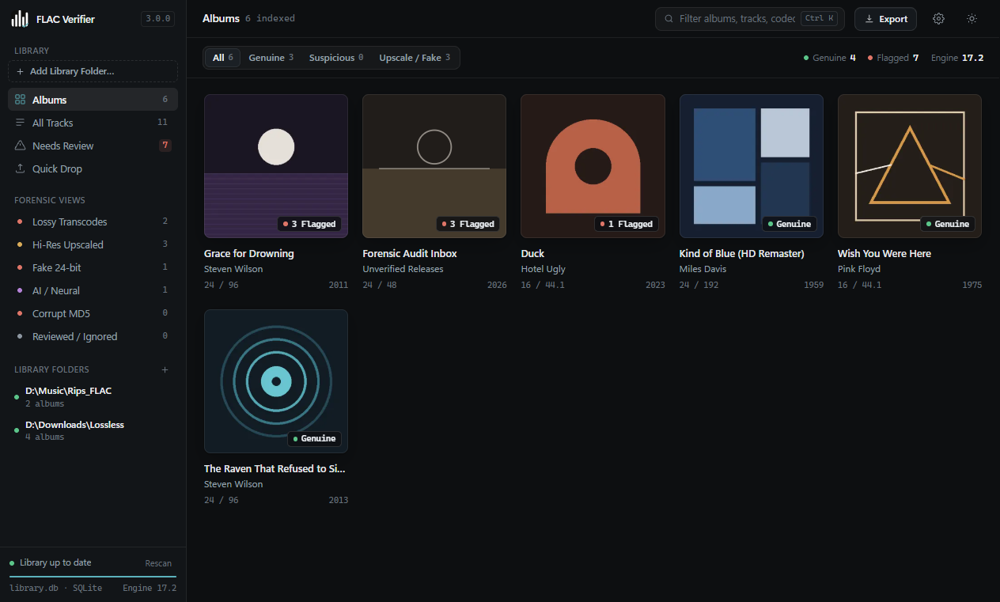
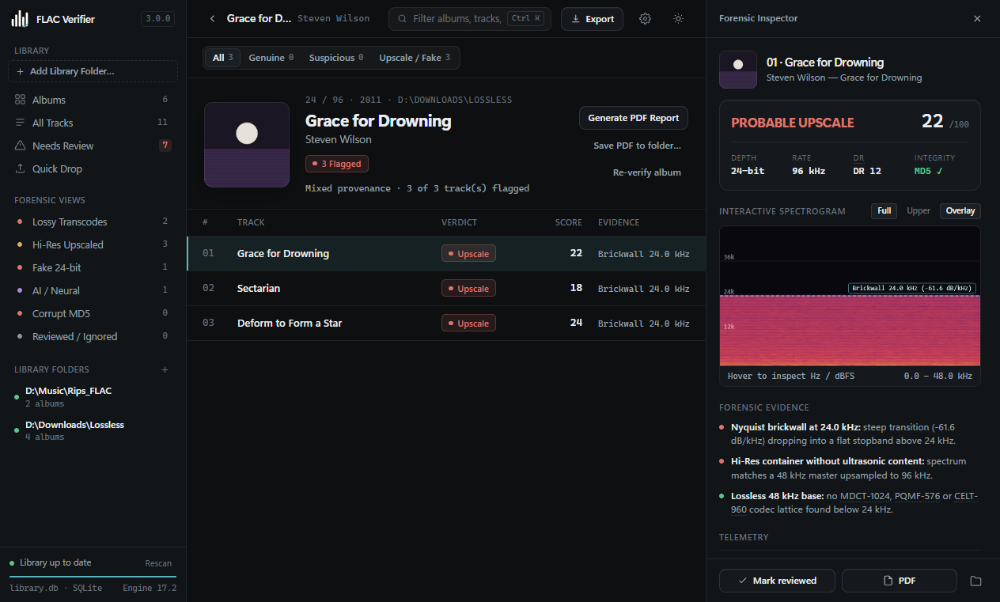
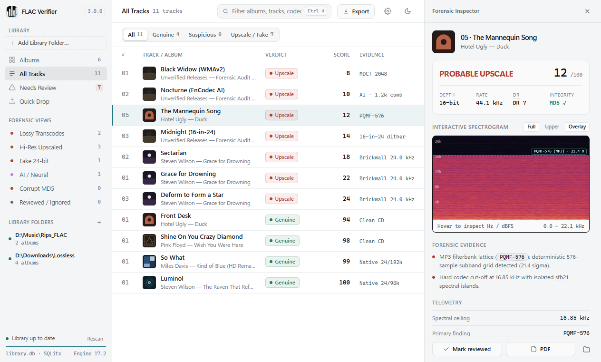
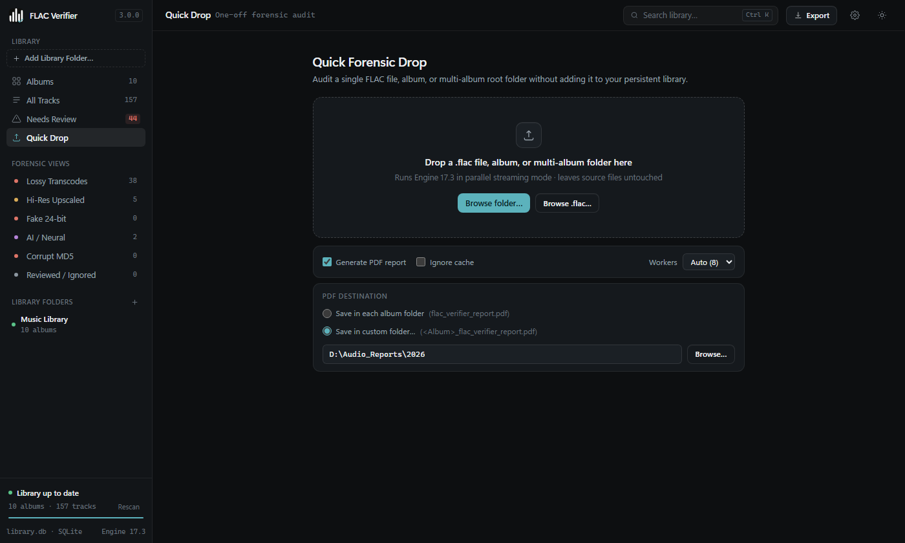

<p align="center">
  
</p>

# FLAC VERIFIER

[](https://github.com/FraysKosher/flac-verifier/actions/workflows/ci.yml)
[](CHANGELOG.md)
[](LICENSE)
[](#tests)

A forensic audio verifier and persistent desktop library manager for deciding
whether a FLAC file is **genuinely lossless** or a fake: a lossy transcode
(MP3, AAC, Vorbis, Opus, WMA…), an AI/neural bandwidth-extended file, or an
inflated bit-depth/sample-rate container (16-in-24/32 padding, dithered
16-in-24, or 44.1/48 kHz upscaled to 96/192 kHz).

<p align="center">
  
</p>

---

## What it checks

- **Bit-exact integrity (`STREAMINFO MD5` & offline AccurateRip v1/v2 CRCs):**
  decodes the PCM stream in a single bounded-memory pass (8/16/24/32-bit integer
  FLAC), verifies the `STREAMINFO MD5` outside the scoring model (mismatch is
  reported immediately as corruption), extracts informative FLAC `vendor`
  metadata, and computes offline Red Book (`16/44.1/2ch`) AccurateRip v1/v2 CRCs
  (`accuraterip`: middle/first/last positions + CD sector alignment).
- **24-bit & 32-bit algebraic lattice & micro-dither audit:** inspects the
  low bits across the whole track (`es_padded_16_en_24`, `es_16bit_dither_en_24`,
  `es_24bit_escalado_en_peine`, DoP markers) and quiet-block spectral floors
  (`noise_shaped_16_in_24`) to catch 16-bit audio stored in 24-bit or 32-bit
  containers—even when masked with $\pm 1\dots 3\text{ LSB}_{24}$ boundary
  dither or noise-shaped 16-bit dither, while sparing genuine `24/44.1` and
  `24/48` warm studio masters (`native_24bit_hf_tail`).
- **Psychoacoustic, spectral & lapped-transform forensics:** detects hard codec
  cut-offs, **orthogonal lapped transform & subband quantization lattices**
  (`MDCT-1024` with both Vorbis and MPEG-4 AAC `KBD` $\alpha=4$ windows across
  `L`/`R`/`Mid` channels for Vorbis `-q4..-q9` & AAC 320, `MDCT-2048` 4096-sample
  Sine window for WMAv2, `PQMF-576` for MP3 320/V0 even with `--lowpass -1`,
  `MDCT-512` `KBD` $\alpha=5$ for AC-3 and E-AC-3, split-half phase-coherent
  `PQMF-32` for Musepack SV7/SV8, `CELT-960` for Opus 20 kHz TDAC boundary
  cancellation with active unclipped-block fallback — plus selective
  fractional-sample TDAC refinement for `+/-0.25/+0.50` sample delayed
  transcodes, sub-splice `3.5–14.8 kHz` `MDCT-1024` detection for AI-spliced
  lossy tracks, `88.2–192 kHz` Hi-Res pure-NumPy decimation bridge, and
  `far_cutoff` codec attribution), **neural super-resolution & AI
  bandwidth-extension forensics** (transposed-convolution vocoder high-frequency
  spectral-comb + phase-coherence detection, commensurate `1,200 Hz` EnCodec
  48 kHz stride-comb detection, and 2D Gram time-domain spectral-folding BWE
  detection across `44.1/48/96/192 kHz`), **seamless QMF subband replication** for
  HE-AAC v1/v2 SBR (at 44.1–192 kHz including guarded low-ceiling `5.5–14.5 kHz`
  solo-piano tracks even without a boundary notch), upper-band 20 kHz
  psychoacoustic modulation, `sfb21` MDCT islands, dynamic Mid/Side stereo
  collapse, inter-channel `MSC`/`IPD` high-frequency stereo phase coupling
  (`stereo_phase_coupling`), diagnostic pre-echo (`pre_echo_ratio_db`) and
  high-frequency Modified Group Delay (`mgd_hf_dispersion`) metrics, harmonic
  exciters, and Gibbs reconstruction clipping.
- **Multi-family corroboration & spectral stationarity guard:** condemning a
  file as `PROBABLE UPSCALE` requires either `>= 2` independent evidence
  families (`corroboracion_multifamilia`) or a deterministic structural proof
  (filterbank lattice, spectral cut-off, or container bit-depth padding/comb),
  while `es_estacionario` protects sustained electronic synthesizer drones and
  modular harmonic pads from false subband-hole or modulation triggers.
- **Hi-Res, DSD & vintage/analogue authenticity:** distinguishes genuine 96/192
  kHz analogue roll-offs, SACD/DSD noise-shaping ramps (`direct_24_40k`,
  `scarlet_30k`, `dsd128_40_80k`), and 1950s–1970s archival tape/vinyl/cassette
  masters (`rolloff_banda_limitada_genuina`) from 22.05/24.0 kHz brickwall
  upscales, aliasing mirrors, and band-limited lossy transcodes.
- **Album-level coherence & ordered reports:** evaluates master consistency
  across the folder, sorts tracks in natural numeric order (`1, 2, …, 10, …,
  100`), and generates a per-album PDF report with embedded spectrograms.

---

## Installation

### Windows Installer (recommended — no Python or admin rights required)

Download **[FLAC_Verifier_Setup_3.0.0-win64.exe](https://github.com/FraysKosher/flac-verifier/releases/tag/v3.0.0)**
and run the per-user installer. It installs into `%LOCALAPPDATA%\Programs\FLAC Verifier`,
preserves your indexed SQLite library (`%APPDATA%\FLAC Verifier\library.db`)
across upgrades, and supports **1-click SHA-256 verified updates** directly from
GitHub Releases (with an *Offline mode* toggle in Settings).

### Windows Portable ZIP

Download **[FLAC_Verifier_3.0.0-win64-portable.zip](https://github.com/FraysKosher/flac-verifier/releases/tag/v3.0.0)**,
extract the `FLAC_Verifier` folder, and run `FLAC_Verifier.exe`. The portable
archive includes `portable.flag`, storing `library.db`, cached covers, and
settings inside `FLAC_Verifier\data\`.

To verify either download against `SHA256SUMS_3.0.0.txt`:

```powershell
Get-FileHash .\FLAC_Verifier_Setup_3.0.0-win64.exe -Algorithm SHA256
Get-FileHash .\FLAC_Verifier_3.0.0-win64-portable.zip -Algorithm SHA256
```

### From source

```bash
# With uv (recommended for CLI/GUI tools) or pipx
uv tool install ".[all]"
flac-verifier

# Or traditional pip in a virtual environment
pip install -r requirements.txt
```

`pywebview` (v3 desktop interface), `reportlab` (PDF report), and legacy
`customtkinter` / `tkinterdnd2` (`--legacy-gui` fallback) are optional; the
engine and CLI work without them.

### Web version

Open the [web version](https://frayskosher.github.io/flac-verifier/) and choose an album folder.

Supported browsers: desktop Chromium and Firefox.

- The first load downloads about 33 MB.

---

## Usage

### Desktop library & forensic studio (`v3.0.0`)

```bash
flac-verifier                            # when installed via uv / pipx
python main.py                           # launches the v3 WebView2 desktop app
python main.py --gui "D:/Music/Album"    # opens Quick Drop ready for a folder
python main.py --legacy-gui              # optional CustomTkinter fallback (source only)
```

Add one or more **Library Folders** (`+ Add Library Folder…`) to recursively
index multi-album collections into a local SQLite WAL database (`library.db`)
with offline `320×320` WebP cover extraction, incremental rescanning, global
forensic filters (`Lossy Transcodes`, `Hi-Res Upscaled`, `Fake 24-bit`,
`AI / Neural`, `Corrupt MD5`, `Reviewed / Ignored`), `Ctrl+K` Command Palette,
keyboard navigation (`↑` / `↓`), CSV/JSON export, and automatic re-verification
prompts whenever `ENGINE_VERSION` advances.

Click any track to open the **Forensic Inspector** with an interactive Magma
Canvas spectrogram (`Full` / `Upper` zoom, live `kHz · dBFS · mm:ss` crosshair,
and toggleable forensic evidence markers) and `Mark reviewed` audit notes:

<p align="center">
  
</p>

Switch between **Dark** and **Light** themes in place (synchronized with the
Windows 11 title bar and saved in `settings.json`):

<p align="center">
  
</p>

Use **Quick Drop** for one-off audits of a `.flac` file, single album, or
multi-album folder tree without adding it to the persistent library (or promote
finished results with *Add to Library*). **Generate PDF report** starts
unchecked by default to avoid unexpected writes during bulk or read-only scans;
when enabled, **PDF destination** lets you choose explicitly between **Save in
each album folder** (default) or **Save in custom folder…** (using
`<Album>_flac_verifier_report.pdf` filenames so multi-album runs never
overwrite earlier reports):

<p align="center">
  
</p>

<p align="center">
  
</p>

### Interactive CLI & Engine CLI

```bash
# Interactive guided console
python verificar_flac.py

# Non-interactive NDJSON engine (for scripts or automation)
python motor_flac.py --path "C:/Music/Album" --pdf
python motor_flac.py --path "C:/Music/Album" --pdf --output-dir "D:/Reports"
python motor_flac.py --path "track.flac" --png --no-cache
```

| Option | Values | Description |
|---|---|---|
| `--path` | path | `.flac` file or album folder (required) |
| `--png` | — | Save PNG spectrograms in the OS user cache directory (`FLAC_VERIFIER_CACHE_DIR` override) |
| `--pdf` | — | Generate the per-album PDF report (implies `--png`) |
| `--output-dir` | path | Destination folder for generated PDF reports (`<Album>_flac_verifier_report.pdf`) |
| `--workers` | integer | Parallel processes (`0` = auto up to 8, `1` = sequential) |
| `--no-cache` | — | Ignore and do not write the per-track result cache |

---

## Verdicts at a glance

| Verdict | Score | Meaning |
|---|---|---|
| `GENUINE LOSSLESS` | ≥ 80 % | Positive spectral and bit-depth evidence with no transcoding or upscale signatures |
| `PROBABLY LOSSLESS` | 60 – 79 % | Clean signal with a conservative or acoustic ceiling, or validated by album coherence |
| `SUSPICIOUS` | 40 – 59 % | Ambiguous high-frequency roll-off or capped by a blocking forensic anomaly |
| `PROBABLE UPSCALE` | < 40 % | Confirmed lossy transcode, Nyquist brickwall upscale, or padded/dithered 16-in-24 container |
| `indeterminate` | — | Unreadable, corrupt, digital silence, or `STREAMINFO MD5` mismatch (never given a fake score) |

For the full scoring weights, detector definitions and NDJSON event schema, see
[`docs/REFERENCE.md`](docs/REFERENCE.md).

---

## Project structure

```text
FLAC VERIFIER/
├── main.py                   single entry point (v3 GUI, CLI, engine, or --legacy-gui)
├── motor_flac.py             analysis engine facade, process pool, cache & CLI (Engine 17.2)
├── _motor_bits.py            MD5, clipping, DR & 24-bit algebraic lattice audit
├── _motor_espectral.py       streaming STFT, psychoacoustic & Hi-Res/DSD detectors
├── _motor_veredicto.py       scoring, verdicts, forensic evidence & album coherence
├── _motor_cache.py           JSON sanitiser & per-track cache I/O
├── library_db.py             SQLite WAL persistent library, forensic filters & exports
├── covers.py                 offline FLAC / sidecar 320x320 WebP cover art cache
├── scan_manager.py           background Library & Quick Drop NDJSON scan orchestrator
├── spectrogram_bridge.py     on-demand compact dBFS spectrogram grid for interactive Canvas
├── gui_v3.py                 Edge WebView2 desktop shell & Python-JS API bridge
├── ui_v3/                    v3 desktop frontend (HTML5 / CSS3 / vanilla ECMAScript modules)
├── updater.py                strict HTTPS + SHA-256 GitHub Releases auto-updater
├── verificar_flac.py         interactive command-line interface
├── gui.py                    legacy CustomTkinter fallback (--legacy-gui, source only)
├── theme.py                  dark & light design tokens shared by PDF and legacy GUI
├── informe_pdf.py            per-album PDF report generator
├── installer/                Inno Setup 6 per-user Windows installer script
├── build.py                  PyInstaller builder, portable ZIP, Inno Setup & SHA-256 metadata
├── comprobar_ejecutable.py   12-check verification suite for the frozen .exe
├── pyproject.toml            PEP 621 metadata & uv / pipx console scripts
├── docs/                     technical reference, design system, validation & screenshots
└── tests/                    497 unit tests (stdlib unittest, synthetic fixtures)
```

Visual identity assets live in `Logo/` (`logo_flac_verifier.png`,
`icono_app.ico`, `logo_flac_verifier.svg`, regenerated by `generar_logo.py`).

---

## Tests & building

```bash
# Run the full 497-test suite (no external audio files needed)
python -m unittest discover -s tests

# Skip Tk GUI tests in headless environments
FLAC_VERIFIER_SIN_GUI=1 python -m unittest discover -s tests

# Build the standalone Windows folder in dist/FLAC_Verifier/
python build.py

# Build full Windows release assets (folder, portable ZIP, Inno Setup .exe, SHA256SUMS, latest.json)
python build.py --release-assets
```

| Test module | Coverage |
|---|---|
| `test_blindaje.py`, `test_protocolo.py`, `test_md5.py` | Corrupt-file safety, strict NDJSON contract, 8/16/24/32-bit MD5 verification |
| `test_veredictos.py`, `test_forense_riguroso.py` | Phase 8–17.2 forensic detectors: 24/32-bit lattice, 16-in-24 micro-dither & noise-shaped dither guard, `24/44.1` studio converter tail, DSD/Hi-Res (including active unclipped-frame 22.05/24 kHz brickwall unmasking), lapped transform & subband lattices (`MDCT-1024` Vorbis/KBD/Sine + sub-splice `3.5–14.8 kHz`, `MDCT-2048` WMAv2, `PQMF-576`, `MDCT-512` AC-3/E-AC-3, `PQMF-32`, `CELT-960` with unclipped fallback, plus Hi-Res `88.2–192 kHz` decimation bridge), neural vocoder comb/phase (`50–250 Hz` + commensurate `1,200 Hz` EnCodec 48 kHz stride comb) & 2D spectral-folding BWE detectors, seamless QMF SBR (including guarded low-ceiling `5.5–14.5 kHz` tracks), inter-channel `MSC`/`IPD` stereo phase coupling, multi-family corroboration, synth stationarity guard, `sfb21` islands, 20 kHz modulation, harmonic exciter, vintage/acoustic exemptions (`4.5–19.4 kHz`) & album coherence |
| `test_rendimiento.py`, `test_cache_y_paralelo.py` | Streaming equivalence, vectorised hot paths, cache invalidation & partial PNG hydration, parallel pool & natural track ordering |
| `test_library_db.py`, `test_covers.py`, `test_scan_manager.py` | SQLite WAL schema, portable mode, Windows path normalization, incremental scans, engine-upgrade coherence, resilient WebP cover caching, background scan pause/resume/cancel, Quick Drop PDF parity & interactive spectrogram bridge |
| `test_gui_v3.py`, `test_updater.py` | WebView2 WSGI server, JS API bridge, native drag-and-drop path validation, settings persistence, strict HTTPS/SHA-256 auto-updater & release metadata |
| `test_gui.py`, `test_theme.py`, `test_informe_pdf.py` | Legacy GUI lifecycle, WCAG contrast tokens, PDF layout & spectrogram embedding |
| `test_estructura.py`, `test_empaquetado.py`, `test_idioma.py` | Architectural boundaries, PyInstaller spec invariants & English-only repository enforcement |

---

## Documentation

- **[`docs/REFERENCE.md`](docs/REFERENCE.md)** — Full NDJSON protocol contract, scoring weights, known physical limits, cache keys and Windows packaging internals.
- **[`CHANGELOG.md`](CHANGELOG.md)** — Release history (`current: 3.0.0`).
- **[`docs/VALIDATION.md`](docs/VALIDATION.md)** — 340-track real-encoder & adversarial benchmark report (41 families) with Wilson 95 % confidence intervals and SHA-256 manifest digest.
- **[`docs/COMPARISON.md`](docs/COMPARISON.md)** — Side-by-side architectural comparison with [FLAC Detective](https://github.com/Guillain-RDCDE/FLAC_Detective).
- **[`docs/DESIGN.md`](docs/DESIGN.md)** — UI/PDF design system and accessibility tokens.
- **[`CONTRIBUTING.md`](CONTRIBUTING.md)** — Development workflow and invariants.
- **[`CODE_OF_CONDUCT.md`](CODE_OF_CONDUCT.md)** — Community standards and reporting guidelines.
- **[`ACCESSIBILITY.md`](ACCESSIBILITY.md)** — Accessibility support, verified contrast, and known GUI limitations.

---

<!-- BENCHMARK:START -->
## Validation benchmark (real `ffmpeg` codecs + adversarial DSP, n = 340)

Generated by `tests/benchmark_validacion.py` (fixed seed `2026`, engine `17.2`):
- **140 authentic controls** across 14 families: CD 16/44.1, Studio 24/48, Hi-Res analogue 24/96, Hi-Res ultrasonic 24/192, DSD64 24/88.2, DSD128 24/192, Acoustic 18 kHz, Solo low-centroid (<15 kHz), Vintage 1950s archival tape (<14 kHz), Vinyl / Cassette / Dense polyphonic synth transfers, Stationary electronic synth drones & genuine 32-bit `PCM_32` masters, Genuine 24/44.1 warm high-DR studio masters, Clean solo piano (5.8-10.2 kHz discrete harmonics with TPDF & noise-shaped dither), and Percussive beat-locked studio mixes.
- **200 fake & adversarial tracks** across 27 families: MP3 (`libmp3lame` 128k / V0 / 320k fullband `-cutoff 22050`, `libshine` 320k), MP2 384k, AAC-LC (128k / 320k fullband `-cutoff 22000`, MediaFoundation 192k), Vorbis (`-q4`, `-q9` 320k fullband, plus 2 unconstrained `-q10` ~500k boundary probes), Opus (96k / 256k fullband `CELT-960`), WMAv2 192k, AC-3 & E-AC-3 16-bit (`MDCT-512`), Hi-Res 96 kHz transcodes masked with ultrasonic hiss, Fractional-delay (`+0.25`/`+0.50` sample) laundered AAC 320 & MP3 320 fullband (`P1-1`), Neural vocoder SR comb & AI-spliced `MDCT-1024` (44.1/48/96k), Time-domain spectral-folding BWE & dark solo-piano seamless SBR (44.1/48/96k), Seamless HE-AAC QMF SBR (0 dB notch at 44.1 & 96 kHz), Musepack SV7/SV8 `PQMF-32`, Vintage 1950s->MP3 transcodes, Sinc/Aliasing upscales, 24-bit zero-pad / gain-comb / boundary micro-dither / noise-shaped 16-in-24 dither, and MPEG-4 AAC `KBD-1024` asymmetric stereo & 16-in-32 container bloat.

| Ground truth | Detected as fake | Detected as authentic |
|---|---:|---:|
| Fake (n = 200) | **TP = 200** | FN = 0 |
| Authentic (n = 140) | FP = 0 | **TN = 140** |

| Metric | Value | Wilson 95% CI |
|---|---:|---:|
| Sensitivity (TPR) | **100.0%** | 98.1% – 100.0% |
| Specificity (TNR) | **100.0%** | 97.3% – 100.0% |

Acceptance criterion: sensitivity >= 95% and specificity >= 95% — **PASS**.

### Album coherence (batch, addition A)

A second batch runs through `analyze_files`: 8 homogeneous GENUINE tracks and
1 acoustic low-ceiling track in the same directory. The acoustic track must be
raised to PROBABLY LOSSLESS with `coherencia_album = true`:

**PASS**

<!-- BENCHMARK:END -->

## License

GNU Affero General Public License v3.0 or later (`AGPL-3.0-or-later`). See [`LICENSE`](LICENSE).
