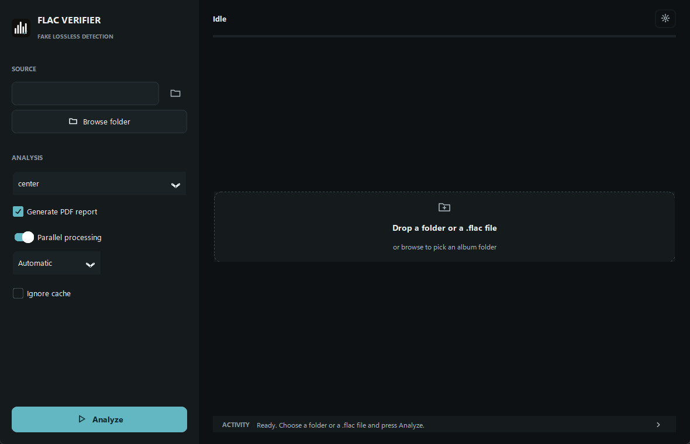

<p align="center">
  
</p>

# FLAC VERIFIER

[](https://github.com/FraysKosher/flac-verifier/actions/workflows/ci.yml)
[](CHANGELOG.md)
[](LICENSE)
[](#tests)

A forensic audio verifier for deciding whether a FLAC file is **genuinely
lossless** or a fake: a lossy transcode (MP3, AAC, Vorbis, Opus, WMA…) or an
inflated bit-depth/sample-rate container (16-in-24/32 padding, dithered 16-in-24,
or 44.1/48 kHz upscaled to 96/192 kHz).

<p align="center">
  
</p>

---

## What it checks

- **Bit-exact integrity (`STREAMINFO MD5`):** decodes the PCM stream in a
  single bounded-memory pass (8/16/24/32-bit integer FLAC) and verifies the MD5
  signature outside the scoring model. A mismatch is reported immediately as
  corruption.
- **24-bit & 32-bit algebraic lattice & micro-dither audit:** inspects the
  low bits across the whole track (`es_padded_16_en_24`, `es_16bit_dither_en_24`,
  `es_24bit_escalado_en_peine`, DoP markers) to catch 16-bit audio stored in
  24-bit or 32-bit containers—even when masked with $\pm 1\dots 3\text{ LSB}_{24}$
  boundary dither.
- **Psychoacoustic, spectral & lapped-transform forensics:** detects hard codec
  cut-offs, **orthogonal lapped transform & subband quantization lattices**
  (`MDCT-1024` with both Vorbis and MPEG-4 AAC `KBD` $\alpha=4$ windows across
  `L`/`R`/`Mid` channels for Vorbis `-q4..-q9` & AAC 320, `PQMF-576` for MP3
  320/V0 even with `--lowpass -1`, `PQMF-32` for Musepack SV7/SV8, `CELT-960`
  for Opus 20 kHz TDAC boundary cancellation), **seamless QMF subband
  replication** for HE-AAC v1/v2 SBR (at 44.1–192 kHz even without a boundary
  notch), upper-band 20 kHz psychoacoustic modulation, `sfb21` MDCT islands,
  dynamic Mid/Side stereo collapse, harmonic exciters, and Gibbs reconstruction
  clipping.
- **Multi-family corroboration & spectral stationarity guard:** condemning a
  file as `PROBABLE UPSCALE` requires either `>= 2` independent evidence
  families (`corroboracion_multifamilia`) or a deterministic structural proof
  (filterbank lattice, spectral cut-off, or container bit-depth padding/comb),
  while `es_estacionario` protects sustained electronic synthesizer drones and
  modular harmonic pads from false subband-hole or modulation triggers.
- **Hi-Res, DSD & vintage/analogue authenticity:** distinguishes genuine 96/192
  kHz analogue roll-offs, SACD/DSD noise-shaping ramps (`direct_24_40k`,
  `scarlet_30k`, `dsd128_40_80k`), and 1950s–1970s archival tape/vinyl/cassette
  masters (`rolloff_banda_limitada_genuina`) from 22.05/24.0 kHz brickwall
  upscales, aliasing mirrors, and band-limited lossy transcodes.
- **Album-level coherence & ordered reports:** evaluates master consistency
  across the folder, sorts tracks in natural numeric order (`1, 2, …, 10, …,
  100`), and generates a per-album PDF report with embedded spectrograms.

---

## Installation

### Windows portable release (no Python required)

Download **[FLAC Verifier 2.9.6](https://github.com/FraysKosher/flac-verifier/releases/tag/v2.9.6)**,
extract the `FLAC_Verifier` folder, and run `FLAC_Verifier.exe`.

To verify the download with `SHA256SUMS_2.9.6.txt`:

```powershell
Get-FileHash .\FLAC_Verifier_2.9.6-win64.zip -Algorithm SHA256
```

### From source

```bash
pip install -r requirements.txt
```

`reportlab` (PDF report), `customtkinter` (GUI) and `tkinterdnd2` (drag and
drop) are optional; the engine and CLI work without them.

---

## Usage

### Graphical interface

```bash
python gui.py
python verificar_flac.py --gui "D:/Music/Album"
```

Drop a folder or `.flac` file onto the window (or click **Browse**), choose
your options on the left rail, and press **Analyze**. Click any row in the
results table to open the track inspector with its spectrogram, technical metrics
and detected issues. Use the top-right sun/moon button to switch between dark
and light themes in place.

### Interactive CLI & Engine CLI

```bash
# Interactive guided console
python verificar_flac.py

# Non-interactive NDJSON engine (for scripts or automation)
python motor_flac.py --path "C:/Music/Album" --mode center --pdf
python motor_flac.py --path "track.flac" --png --no-cache
```

| Option | Values | Description |
|---|---|---|
| `--path` | path | `.flac` file or album folder (required) |
| `--mode` | `center` \| `full` \| `seconds` | Spectral window: `center` (default: 45 s of highest-energy active blocks), `full` (up to 60 s of active blocks across the whole track), or `seconds` (first N seconds) |
| `--seconds` | integer | Prefix window in seconds when `--mode seconds` (default `15`) |
| `--png` | — | Save spectrograms in `<folder>/_spectrograms/` |
| `--pdf` | — | Generate `flac_verifier_report.pdf` in the album folder (implies `--png`) |
| `--workers` | integer | Parallel processes (`0` = auto up to 8, `1` = sequential) |
| `--no-cache` | — | Ignore and do not write the per-track result cache |

---

## Verdicts at a glance

| Verdict | Score | Meaning |
|---|---|---|
| `GENUINE LOSSLESS` | ≥ 80 % | Positive spectral and bit-depth evidence with no transcoding or upscale signatures |
| `PROBABLY LOSSLESS` | 60 – 79 % | Clean signal with a conservative or acoustic ceiling, or validated by album coherence |
| `SUSPICIOUS` | 40 – 59 % | Ambiguous high-frequency roll-off or capped by a blocking forensic anomaly |
| `PROBABLE UPSCALE` | < 40 % | Confirmed lossy transcode, Nyquist brickwall upscale, or padded/dithered 16-in-24 container |
| `indeterminate` | — | Unreadable, corrupt, digital silence, or `STREAMINFO MD5` mismatch (never given a fake score) |

For the full scoring weights, detector definitions and NDJSON event schema, see
[`docs/REFERENCE.md`](docs/REFERENCE.md).

---

## Project structure

```text
FLAC VERIFIER/
├── main.py                   single entry point (GUI, CLI or engine)
├── motor_flac.py             analysis engine facade, process pool, cache & CLI
├── _motor_bits.py            MD5, clipping, DR & 24-bit algebraic lattice audit
├── _motor_espectral.py       streaming STFT, psychoacoustic & Hi-Res/DSD detectors
├── _motor_veredicto.py       scoring, verdicts, forensic evidence & album coherence
├── _motor_cache.py           JSON sanitiser & per-track cache I/O
├── verificar_flac.py         interactive command-line interface
├── gui.py                    CustomTkinter desktop interface
├── theme.py                  dark & light design tokens shared by GUI and PDF
├── informe_pdf.py            per-album PDF report generator
├── build.py                  PyInstaller builder & post-build verifier
├── comprobar_ejecutable.py   12-check verification suite for the frozen .exe
└── tests/                    351 unit tests (stdlib unittest, synthetic fixtures)
```

Visual identity assets live in `Logo/` (`logo_flac_verifier.png`,
`icono_app.ico`, `logo_flac_verifier.svg`, regenerated by `generar_logo.py`).

---

## Tests & building

```bash
# Run the full 351-test suite (~90 s, no external audio files needed)
python -m unittest discover -s tests

# Skip GUI tests in headless environments
FLAC_VERIFIER_SIN_GUI=1 python -m unittest discover -s tests

# Build the standalone Windows folder in dist/FLAC_Verifier/
python build.py
```

| Test module | Coverage |
|---|---|
| `test_blindaje.py`, `test_protocolo.py`, `test_md5.py` | Corrupt-file safety, strict NDJSON contract, 8/16/24/32-bit MD5 verification |
| `test_veredictos.py`, `test_forense_riguroso.py` | Phase 8–13 forensic detectors: 24/32-bit lattice, 16-in-24 micro-dither, DSD/Hi-Res, 24 kHz brickwall, lapped transform & subband lattices (`MDCT-1024` Vorbis/KBD/Sine, `PQMF-576`, `PQMF-32`, `CELT-960`), seamless QMF SBR, multi-family corroboration, synth stationarity guard, `sfb21` islands, 20 kHz modulation, harmonic exciter, vintage/acoustic exemptions & album coherence |
| `test_rendimiento.py`, `test_cache_y_paralelo.py` | Streaming equivalence, vectorised hot paths, cache invalidation & partial PNG hydration, parallel pool & natural track ordering |
| `test_gui.py`, `test_theme.py`, `test_informe_pdf.py` | GUI lifecycle, dark/light live retheming, WCAG contrast, PDF layout & spectrogram embedding |
| `test_estructura.py`, `test_empaquetado.py`, `test_idioma.py` | Architectural boundaries, PyInstaller spec invariants & English-only repository enforcement |

---

## Documentation

- **[`docs/REFERENCE.md`](docs/REFERENCE.md)** — Full NDJSON protocol contract, scoring weights, known physical limits, cache keys and Windows packaging internals.
- **[`CHANGELOG.md`](CHANGELOG.md)** — Release history (`current: 2.9.6`).
- **[`VALIDATION.md`](VALIDATION.md)** — 260-track real-encoder & adversarial benchmark report with Wilson 95 % confidence intervals and SHA-256 manifest digest.
- **[`COMPARISON.md`](COMPARISON.md)** — Side-by-side architectural comparison with [FLAC Detective](https://github.com/Guillain-RDCDE/FLAC_Detective).
- **[`DESIGN.md`](DESIGN.md)** — UI/PDF design system and accessibility tokens.
- **[`CONTRIBUTING.md`](CONTRIBUTING.md)** — Development workflow and invariants.

---

<!-- BENCHMARK:START -->
## Validation benchmark (real `ffmpeg` codecs + adversarial DSP, n = 260)

Generated by `tests/benchmark_validacion.py` (fixed seed `2026`, engine `13.6`):
- **110 authentic controls** across 11 families: CD 16/44.1, Studio 24/48, Hi-Res analogue 24/96, Hi-Res ultrasonic 24/192, DSD64 24/88.2, DSD128 24/192, Acoustic 18 kHz, Solo low-centroid (<15 kHz), Vintage 1950s archival tape (<14 kHz), Vinyl / Cassette / Dense polyphonic synth transfers, and Stationary electronic synth drones & genuine 32-bit `PCM_32` masters.
- **150 fake & adversarial tracks** across 21 families: MP3 (`libmp3lame` 128k / V0 / 320k fullband `-cutoff 22050`, `libshine` 320k), MP2 384k, AAC-LC (128k / 320k fullband `-cutoff 22000`, MediaFoundation 192k), Vorbis (`-q4`, `-q9` 320k fullband, plus 2 unconstrained `-q10` ~500k boundary probes), Opus (96k / 256k fullband `CELT-960`), WMAv2 192k, Seamless HE-AAC QMF SBR (0 dB notch at 44.1 & 96 kHz), Musepack SV7/SV8 `PQMF-32`, Vintage 1950s->MP3 transcodes, Sinc/Aliasing upscales, 24-bit zero-pad / gain-comb / boundary micro-dither, and MPEG-4 AAC `KBD-1024` asymmetric stereo & 16-in-32 container bloat.

| Ground truth | Detected as fake | Detected as authentic |
|---|---:|---:|
| Fake (n = 150) | **TP = 150** | FN = 0 |
| Authentic (n = 110) | FP = 0 | **TN = 110** |

| Metric | Value | Wilson 95% CI |
|---|---:|---:|
| Sensitivity (TPR) | **100.0%** | 97.5% – 100.0% |
| Specificity (TNR) | **100.0%** | 96.6% – 100.0% |

Acceptance criterion: sensitivity >= 95% and specificity >= 95% — **PASS**.

### Album coherence (batch, addition A)

A second batch runs through `analyze_files`: 8 homogeneous GENUINE tracks and
1 acoustic low-ceiling track in the same directory. The acoustic track must be
raised to PROBABLY LOSSLESS with `coherencia_album = true`:

**PASS**

<!-- BENCHMARK:END -->

## License

MIT. See [`LICENSE`](LICENSE).
